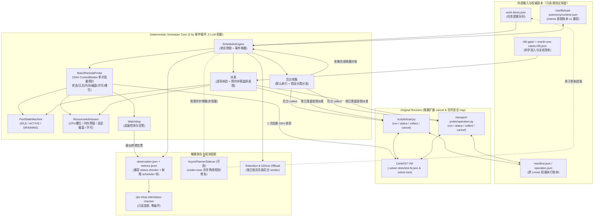
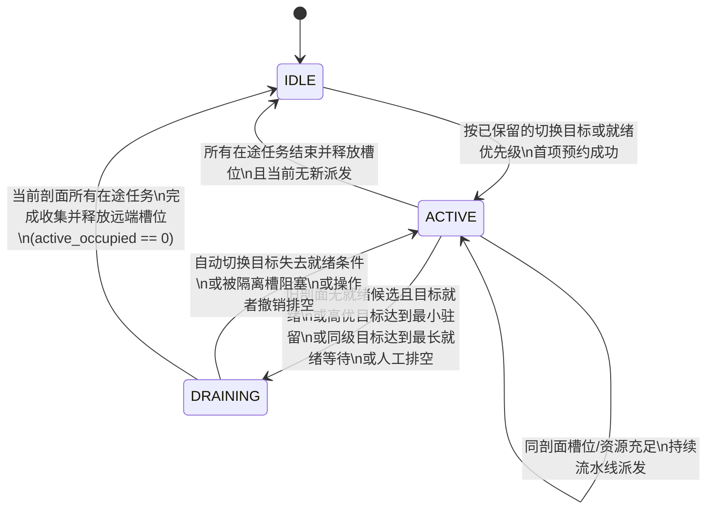
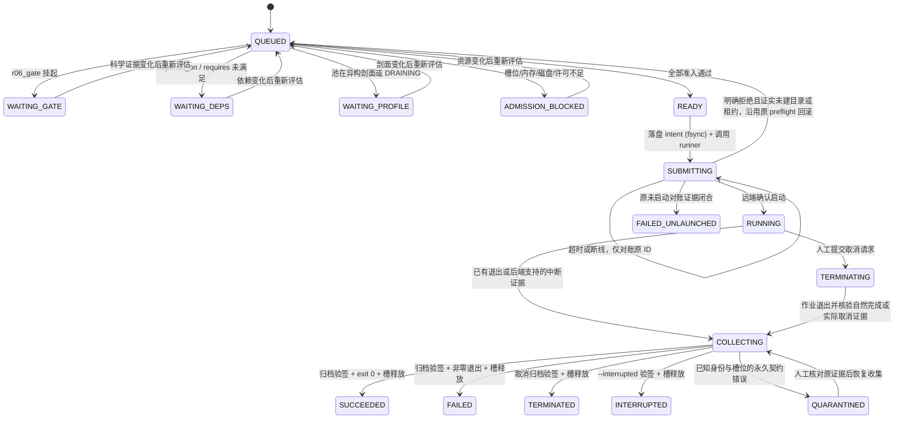

# TCAD / Geant4 生产级仿真调度器重构架构与实施计划

## Goal Description

在现有 `tcad-research-training/automation/server-codex/` 和原运行器上分阶段改造：先让对账、收集和派发独立于 `codex exec`，再完善取消、隔离和受限并发。全过程沿用既有科学约束、历史账本、远端共享池和公开状态页契约。本文只记录设计和验收条件，代码与服务器操作另行安排。

### 现状 8 大实测故障与根因映射

| # | 生产实测问题 | 源码根因定位 | 新架构根治手段 |
|---|---|---|---|
| 1 | **池子假死**（`active=2 / running=0 / draining=true` 停摆 25 分钟） | `runtime.py:1157,1174` 把“已结束未收集”计入 `live`，并用隐式布尔量 `draining` 阻塞**全部**候选任务；收集退避期间槽位长期死占 | 显式区分运行、后台收集和隔离槽位；排空期间继续对账与收集 |
| 2 | **无取消接口**（`_stop_stalled()` 空实现；人工 SIGTERM 后 `run.sh` trap 写 0；重收撞 `.collection/results.tar` 不可变快照冲突） | `runtime.py:716` 空实现；`tcad.py:2342` & `operation.py:317` 缺 `TERM`/`INT` trap 且不传播信号给子进程组；`SNAPSHOT_CODE` 在校验失败前即封存远端快照 | 在 `tcad.py` / `operation.py` 新增一等公民 `cancel` 命令与信号安全 `run.sh` trap；支持经 `termination-request.json` 审计的取消归档通道 |
| 3 | **调度与 LLM 生命周期耦合** | `controller.py` 已能在模型等待时监督同一 `Runtime`，但服务入口、模型预检和调度循环仍耦合 | 调度独立运行；模型只按需异步准备证据、输入和提案，其退出、超时或缺失不拖住已有队列 |
| 4 | **剖面切换隐式**（靠 `draining` 从候选列表倒推，无优先级与显式排空态） | `runtime.py:1157-1164` 仅按 `last_submission_schema` 交替，无优先级、无驻留时间防抖、无显式目标剖面 | 显式 `PoolStateMachine`（含 `ACTIVE -> DRAINING(from, to) -> IDLE -> ACTIVE`）、声明式优先级与 `min_profile_dwell_seconds` 防抖、支持人工 `drain --to` |
| 5 | **收集重试粗粒度固定退避**（300s×2^n，出错期间死占槽位） | `runtime.py:709-714,803-805` 未充分区分网络、锁忙、重启中断和契约冲突 | 锁忙和网络分别退避；有原始证据的重启中断走各后端的恢复通道；已确认的永久契约错误立即隔离 |
| 6 | **资源准入缺失**（主要看槽位和线程数） | `runtime.py` 未纳入实时内存、磁盘写入余量和 Sentaurus 许可状态 | 校验 CPU 槽位、虚拟机内存和启动预留、各实际写入层的磁盘余量，以及 TCAD 许可健康与席位反馈 |
| 7 | **可观测性差**（零散字符串、无状态机、无指标、无“为何本轮无动作”单一答案） | `observation.json` 仅输出扁平 `pending_tasks` 字符串，无决策摘要与性能指标 | 显式任务/池状态机 + 每轮 `last_decision` 单一因果摘要 + 结构化指标（`metrics` + `metrics.jsonl`）+ `explain` CLI |
| 8 | **空槽补位慢** | 30s 轮询、逐任务 SSH 探测、同步收集；运行器入口还共享本地所有者锁 | 复用 SSH、批量只读探测、完成事件唤醒；先让收集离开主循环，再按锁边界逐步开启受限并发 |

---

## 不变约束

> [!IMPORTANT]
> **零破坏性底线（科学约束与历史账本不可变）**
> 1. **原共享池与槽位协议不变**：严格沿用 `/home/tcad/research-training/.solver-slots/slot-N.json`（`tcad-shared-gate-slots-v2` / `r3` / `r4`）与 `.solver.lock`，**不另开池**。
> 2. **四层账本边界不变**：`month-one-cases-r06.json`（只读计划）、`work-items.json`（提案队列）、`/var/lib/tcad-autonomy/runtime.json`（`tcad-autonomy-intents-v1` 意图账本）、原 `manifest.json` / `operation.json`（权威执行事实源）均保持原路径与向后兼容 schema，**不覆盖或迁移任何历史 run ID、失败记录或 `scientific_admission`**。
> 3. **r0.6 科学准入完全保留**：所有提交前仍强制通过 `r06_gate.py` 的 fail-closed 逐提交核验（P0 64/12 预算、P0 科学总闸、sampling verifier、training freeze、repair 谱系与 `scientific_object` 一致性）。
> 4. **下游 `status-checker` 100% 兼容**：`/var/lib/tcad-autonomy/observation.json` 保留所有被 `xjtu-shop-site/status-checker/` 消费的字段与语义（`utc`、`runs[]` 的 `status/collected/success/occupied/terminal_reconciled`、`queue_complete`、`fresh_max_age_seconds`、`capacity`、`requested_threads`、`controller_mode`）；新结构化状态机、决策摘要和指标仅作为**增量字段**写入 `observation.json["scheduler"]`。

> [!WARNING]
> **取消请求和执行结果分开记录。** 自然完成且原证据一致时照常收集，额外记录取消请求未生效。只有证实取消生效、确认作业退出并完成归档核验后，才记录 `FAILED_COLLECTED` 和 `execution_outcome: "TERMINATED_BY_OPERATOR"`；`termination_record` 保存请求方、原因、时间、实际信号、是否升级及证据引用。保留原始退出码和缺失情况，必要时单独记录由实证信号推导的退出码及其来源。Watchdog 首版只告警。

> [!CAUTION]
> **云端只改代码与测试，不直接执行生产部署**
> 依据仓库 `AGENTS.md`，云端实现仅做代码、测试、打包脚本和文档并通过 PR 交付。生产切换另行确认和执行；涉及调度配置或池协议的变更须等待在途任务自然结束并完成收集、原租约释放、相关锁空闲，且无未登记求解器。

---

## 四项架构决策

1. **Codex 侧车：切换验证用 `disabled`，正式无人值守用 `on_demand_async`。** 只有出现新证据、新修复请求或确实缺下一批提案时才按需唤醒；同一事件去重，同一时刻只运行一个规划进程。侧车只准备科研证据、候选冻结输入和队列提案，保留 Sol→Astra 按需咨询；不直接调用运行器、改已提交输入、写入意图或操作槽位。新提案仍由唯一调度器按原 r0.6 科学闸核验。禁用模式不依赖 Codex 二进制、模型路由或凭据；侧车失败或超时独立退避，已准入任务照常派发和收集。

2. **剖面切换：优先级、最小驻留和最长就绪等待并用。** 根据 [2026-11-20 上线记录](tcad-research-training/docs/server-workflow.md) 的配置基线，虚拟机 17 核／28 GiB，TCAD 为 `12×1+1×4` 共 13 槽，Geant4 沿用原 profile、实际最多 4 项并发。分别读取 profile 槽位容量与派发上限，沿用同一共享池。`priority` 越小越优先，缺省 `100`，同级按修复优先、队列次序排序。目标任务先满足科学准入、依赖和冻结输入要求，并在旧剖面排空后具备取得资源的条件。旧剖面没有等待补槽的就绪任务且目标就绪时直接排空；槽位暂满、资源短暂不足不视为队列耗尽。因目标优先级更高而切换时，默认等旧剖面驻留满 `1800s`；同级目标持续就绪达到可配置等待上限时也开始排空，建议试运行初值 `7200s`。等待上限约束何时停止补旧槽，实际切换仍等在途自然结束和租约释放。人工 `drain --to` 在切换完成前持续有效，除非操作者撤销或修改。

3. **资源准入：先用试运行水位，满载单独验收。** 虚拟机可用内存停发线先用 `3.5 GiB`；单核 TCAD、四核 TCAD、单核 Geant4 的 `1.5 / 4.0 / 1.5 GiB` 仅作估算初值，不据此放开 13 槽满载。优先复用代表性长任务采样，按后端、任务类型和线程数校准，再逐档加并发。服务器剩余空间先留 `20 GiB`，虚拟机剩余空间先留 `10 GiB`；另检查服务器上虚拟机磁盘文件可增长空间，以及在途输出、快照和传输临时副本的实际占用。空间不足时暂停相关新提交或打包，保留原任务和租约。`lmgrd`、`snpslmd` 存活只用于健康判断；可用许可席位参考缓存的 `lmstat` feature 查询或原运行器返回的许可反馈。

4. **永久契约错误：保留原租约，只隔离已知坏槽。** 原身份与对应槽位已确认、作业已退出但归档遇到确定的契约冲突时，进入 `QUARANTINED`，停止自动重试；同剖面其它符合准入的空槽继续工作。自动排空遇隔离槽时，记录 `blocked_by_quarantined_slot`，暂停该切换请求并恢复旧剖面补槽，直到隔离解除或阻塞条件变化再重新评估。人工排空保留原目标，等操作者处理。恢复沿用原快照和原 ID，经证据核验重收或失败结案；结果证据不足、身份不明或锁仍被持有时保留占位。首版不提供绕过核验的强制收集或释放命令。

---

## 改造方案

### 实施顺序

1. **先独立调度和观测。** 保留现有 `Runtime`，接入批量只读探针、独立调度循环和 `explain`。主循环处理对账、决策和完成事件；沿用原所有者锁，由单个后台执行通道串行调用需要该锁的运行器命令。验证阶段关闭侧车。
2. **再做取消和恢复。** 增加两套运行器的人工取消、失败归档和隔离处置；看门狗只告警。对账和回滚先验证旧、新版本均能读取切换时会留下的有效记录。
3. **最后开启受限并发和按需规划。** 明确所有者锁、单任务写入和原远端租约的边界后，才允许不同任务并行收集；派发仍串行核验科学与资源并落盘预约。依据实际资源采样逐档放开并发，验证阶段通过后正式启用按需侧车。

### 总体架构蓝图



### 核心状态机设计

#### 1. 池剖面显式状态机（`PoolStateMachine`）



- **排空与运行进度分开**：
  - `DRAINING` 仅禁止**新任务进入旧剖面**，绝不阻止旧剖面在途任务的 `RUNNING -> COLLECTING -> RELEASED` 推进。
  - `alive=false` 只触发收集或继续核对；旧租约全部释放且原池锁与未登记进程检查通过后才进入 `IDLE`。切换目标保留到目标剖面第一项预约成功，避免空池时重新排序丢掉已等待的目标。
  - 在 `runtime.json["pool_state"]` 持久化切换目标、来源（人工或自动）、时间和阻塞原因；重启时先与实际租约、未登记进程及未确认提交对账，再恢复派发。隔离阻塞未变化时不反复自动排空。

#### 2. 任务显式状态机（`TaskState`）



---

### 组件级改动清单

---

### 组件 1：原 Runner 增量增强（正规取消通道 + 信号安全 `run.sh` + 错误结构化）

#### [MODIFY] `tcad-research-training/scripts/tcad.py`
1. **为新任务生成可核验的独立作业进程组。** 记录真实组身份，保留原 `run.sh` 输入冻结和哈希流程。信号处理须等原子进程退出，记录收到的信号和退出回执；wrapper 不在回执落盘前向自己再次发送终止信号。原历史脚本和哈希不变。
2. **新增人工 `cancel <run_id> --reason <str> [--grace-seconds 15] [--json]`。** 在原所有者和作业锁约束下，核对 manifest、租约、PID、启动时刻、boot、工作目录、脚本哈希及实际作业组。先原子写 `termination-request.json`，在发信号前和升级前重查身份；确认退出或身份不明时停止发信号。确认整个作业组及相关后代进程退出，保留实际信号和退出证据；最终由收集流程取得原锁并释放租约。旧 wrapper 缺少可验证的独立作业组时转人工核查，不扩大信号范围。
3. **收集按证据区分自然完成、实际取消与未知。** 自然完成仍按原成功／失败规则归档；只有实际信号和退出证据支持的取消进入失败归档。强制终止后缺失原退出码时，可由经核验的终止回执推导归档退出码并注明来源（例如 `137`），不得补写或覆盖原 `exit-code.txt`。原日志、输出、快照和归档只追加证据；已有不可变快照冲突时进入隔离，恢复须单独核验并保留原件。结构化输出 `CONTRACT_MISMATCH`、`LOCK_BUSY`、`TRANSFER_INCOMPLETE` 等错误，未知错误保留原占位供对账。

#### [MODIFY] `tcad-research-training/experiments/dram-see-v4/transport-probe/operation.py`
- 与 `tcad.py` 对齐：
  1. 在 `render_wrapper` 为新任务记录独立作业组，保留 `operation_task_pid` 对应的进程与退出证据。
  2. 新增人工 `cancel <label> --reason <str> [--grace-seconds 15] [--json]` 子命令。
  3. `collect_operation` 验证请求、真实信号、退出和归档证据，按相同终态语义记录并释放槽位。当前没有 `collect --interrupted`；Geant4 重启中断须先定义和验证专用恢复证据，通道未具备时保留原占位并报告待对账。

---

### 组件 2：在原 `Runtime` 上拆出确定性调度循环

在 `tcad-research-training/automation/server-codex/` 下按单一职责拆分为轻量、无外部重型依赖（纯 Python 标准库）的清晰模块：

#### [NEW] `tcad-research-training/automation/server-codex/scheduler_models.py`
- 定义强类型枚举与数据契约（`@dataclass` / `Enum`）：
  - `TaskState`：`QUEUED`, `WAITING_GATE`, `WAITING_DEPS`, `WAITING_PROFILE`, `ADMISSION_BLOCKED`, `READY`, `SUBMITTING`, `RUNNING`, `TERMINATING`, `COLLECTING`, `SUCCEEDED`, `FAILED`, `TERMINATED`, `INTERRUPTED`, `FAILED_UNLAUNCHED`, `QUARANTINED`。
  - `PoolState`：`IDLE`, `ACTIVE`, `DRAINING`。
  - `ErrorClass`：`TRANSIENT_LOCK_BUSY`, `TRANSIENT_NETWORK`, `INTERRUPTED_REBOOT`, `PERMANENT_CONTRACT_ERROR`, `UNKNOWN`。
  - `AdmissionVerdict`（`allowed: bool`, `blocking_dimension: str | None`, `detail: str`, `snapshot: dict`）。
  - `TickDecision`（每轮单一决策答案：`action`, `primary_reason`, `summary`, `dispatched`, `collected`, `terminated`, `quarantined`, `blocked_breakdown`, `duration_ms`）。

#### [NEW] `tcad-research-training/automation/server-codex/scheduler_probe.py`
- **SSH ControlMaster 持久连接池 + 单次批量远端探针（`BatchRemoteProbe`）**：
  - 复用原 connection profile 的 `ssh_target` 和 `runtime_entry`，在 `<state_dir>/ssh-mux/` 下维护 `ControlMaster=auto -o ControlPersist=120s` 复用通道（绝不修改用户 `~/.ssh/config`，且不传入代理或 LLM 凭据）。
  - **一次 SSH 调用执行只读批量探针**，输入为当前全部活跃/未终态 intent 列表，单次 JSON 返回：
    1. 每个活跃 run 的实时状态：`alive`、`remote_exit_code`、`boot_id`、`status`（`RUNNING/FINISHED/LOST_WITHOUT_EXIT/START_UNCONFIRMED`）、进程树聚合 `rss_kib`、最后 4 KiB `transient_log_tail` / `log_tail`。
    2. 远端 `.solver-slots/slot-*.json` 与 `capacity.json` 快照（发现外部/未释放槽位）。
    3. 远端系统遥测：`/proc/meminfo`（`MemTotal`, `MemAvailable`）、远端 `data_root`/`remote_root` 的 `statvfs` 可用磁盘字节、`lmgrd` & `snpslmd` 存活状态与可选 `lmstat` 缓存。
  - **严格只读**：探针绝不修改远端锁或 manifest；状态变更的权威落盘仍全部经由原 runner（`collect` / `cancel` / `run`）完成。
  - 若批量探针遇到 SSH 断线，触发端点级退避（`5s -> 15s -> 45s -> 120s`，上限 `300s`）。观测过期时标记未知并保留最后一次成功探测的时间；不依据旧读数派发、切换、取消或释放租约。

#### [NEW] `tcad-research-training/automation/server-codex/scheduler_pool.py`
- **显式剖面状态机（`PoolStateMachine`）与任务优先级排序器**：
  - 从 `connection`、`transport_connection` 和 policy 读取原 CPU 集、槽位容量及实际并发上限；TCAD 基线为 `12×1+1×4`，Geant4 维持原 profile 和最多 4 项并发。历史记录按其原 profile 对账。
  - 显式状态转移：
    - `reconcile(live_slots, ready_by_profile, manual_drain_target, now)` -> `(PoolStateSnapshot, transition_event | None)`。
    - 仅统计**真正占用远端槽位且未释放**的 `occupied_slots`（严格区分 `running_slots`、`collecting_slots`、`quarantined_slots`）。
    - 已确认的 `QUARANTINED` 槽只占自己的 slot ID。影响范围未查明的原池身份异常仍暂停新派发，等原事实澄清。
  - 优先级队列排序：`(explicit_priority, is_not_repair, queue_order)`；按 `min_profile_dwell_seconds` 和 `max_profile_ready_wait_seconds` 触发自动排空，人工目标单独保留。

#### [NEW] `tcad-research-training/automation/server-codex/scheduler_admission.py`
- **四维资源准入控制器（`ResourceAdmissionController`）**：
  - **维度 1：CPU 与槽位宽度**（沿用 `_eligible_slots` + `native_threads == native_cores` 校验）。
  - **维度 2：内存准入与保守预留**：
    - 计算 `effective_available_gib = remote_mem_available_gib - pending_launch_reserve_gib`。
    - 对已预约但尚无实测的任务保留完整估算额度；已运行且实测 RSS 低于估算峰值时只补差额 `sum(max(0, est_rss - actual_rss))`。同轮每个预约立即进入预留，防止重复使用同一份可用内存。
    - 检查 `effective_available_gib - task_est_gib >= min_available_memory_gib`。
  - **维度 3：磁盘准入**：
    - 分别检查服务器收集路径的剩余空间（`min_host_disk_free_gib`，初值 `20 GiB`）、虚拟机工作路径的剩余空间（`min_remote_disk_free_gib`，初值 `10 GiB`）和底层实际写入余量，不合并各层数字。
    - 新提交和新打包各按其实际写入路径检查剩余空间及已预留的在途输出、快照和传输临时副本。空间不足时相应动作等待，保留原占位和状态；原有核验后的回收可继续。
  - **维度 4：TCAD 许可准入**：
    - 仅对 TCAD 检查 `license_daemons_alive`；得到缓存的 feature 余量或原运行器的许可不足反馈时，从对应资源准入分流。席位未测则标记未知，保留原运行器核验；Geant4 不受此检查影响。

#### [NEW] `tcad-research-training/automation/server-codex/scheduler_collector.py`
- **异步并发收集器池（`AsyncCollectorPool`）+ 错误分类器（`classify_collection_error`）**：
  - 首版后台串行，`collect_concurrency=1`。原 CLI 子进程共用非阻塞的全局所有者锁，直接并行会互相抢锁；只有唯一所有者、按任务的账本写入互斥以及原远端租约都经过验证后，才按实测调高并发。
  - 观测到作业已退出且有可验证的退出、取消或中断证据时进入 `COLLECTING`；同一原 ID 最多有一个在途操作，取消、收集和结果回收互斥。
  - 完成回调唤醒主循环对账。仅在运行器验证归档并确认原租约已释放后，才可把槽位分配给下一项任务；归档完成但释放未确认时，只沿原 ID 补收集／释放闭环。
  - 错误分类与差异化退避：
    - `TRANSIENT_LOCK_BUSY`（exit 75）：退避 `2s -> 5s -> 10s -> 30s`（最多 6 次后转人工提示）。
    - `TRANSIENT_NETWORK`（exit 255 / SSH timeout / transfer incomplete）：退避 `5s -> 15s -> 45s -> 120s -> 300s`。
    - `INTERRUPTED_REBOOT`：TCAD 使用原中断证明和 `collect --interrupted`；Geant4 在有专用通道前报告待对账，保留原租约。
    - `PERMANENT_CONTRACT_ERROR`：已确认的归档契约冲突不自动重试，标为 `QUARANTINED`，保留原快照及租约，并报告处置所需证据。`identity mismatch` 或未知错误先核对影响范围，不按普通坏归档释放或猜测终态。

#### [NEW] `tcad-research-training/automation/server-codex/scheduler_engine.py`
- **核心确定性调度引擎（`SchedulerEngine`）**：
  - 兼容读取并原子落盘 `/var/lib/tcad-autonomy/runtime.json`（保留 `schema: "tcad-autonomy-intents-v1"` 和全部既有 `intents` 字段，增量记录 `pool_state` 与可选任务调度元数据）。
  - 完整保留 `r06_gate.py` 科学准入、`_inputs` 哈希校验、`repair` 谱系防重复输入、`adopt_run_id` 接管、`intent_reconciliation` 未启动对账、以及 `_maintain_results` / `_offload_results` 后台维护。
  - **高吞吐主循环**（默认 `poll_interval_seconds: 5`，可由收集完成 / 队列文件变更 / 人工指令事件提前唤醒）：
    1. 校验 `can_submit()` 与身份指纹（`identity_stamp`）。
    2. 加载 `work-items.json`（带 mtime/size 缓存，未变不重复全量解析）。
    3. 执行一次 `BatchRemoteProbe` 拿到全部活跃任务状态 + 远端遥测。
    4. 对 `RUNNING` 的 TCAD 任务执行 `watchdog.evaluate_watchdog`，首版仅记录告警；取消须来自人工操作。
    5. 将已确认退出或中断且具备恢复通道的任务交给后台收集；对账收集结果和已释放的原租约，由主循环统一更新 `intents`。
    6. 评估 `PoolStateMachine`（`IDLE / ACTIVE / DRAINING`）。
    7. 对 `READY` 任务逐项重查 `pause` / `disarm`、剖面、资源、冻结输入和 `r06_gate`。校验成功后先预约槽位和资源、持久化包含 `scientific_admission` 的原 ID 意图，再核验下一项；P0 64/12 和 repair 谱系必须计入这些已落盘预约。提交返回不确定时只对账原 ID；只有经原协议证实从未启动时才按原规则处理。
    8. 计算 `TickDecision` 与结构化指标，轮转 `<state_dir>/metrics.jsonl`；原子写入 `/var/lib/tcad-autonomy/observation.json`，保留既有字段语义，只增补 `scheduler` 诊断。观测失联期间不把旧远端状态刷新成当前事实。
  - 暴露正规操作原语：`cancel_task(task_id, reason, by="operator")`、`request_drain(target_profile, reason)`、`cancel_drain()`、`explain()`。

#### [NEW] `tcad-research-training/automation/server-codex/scheduler_planner.py`
- **解耦的异步 LLM 规划侧车（`AsyncPlannerSidecar`）**：
  - 将原 `controller.py` 中的 `prepare_codex` / `prompt_for` / `run_cycle` / `should_wake` / `advisor` 逻辑抽离到此独立模块。
  - 支持三种策略模式（`policy["planner_mode"]`）：
    - `"disabled"`：切换验证用，不启动 `codex exec`，调度预检不要求模型配置或凭据。
    - `"on_demand_async"`：正式无人值守用，由新证据、新修复请求或确需下一批提案的事件唤醒。单独限时退避，规划写入仅限候选输入和提案交接目录；调度主循环继续运行，不受侧车状态影响。

---

### 组件 3：控制器入口、兼容性桥接与打包配置

#### [MODIFY] `tcad-research-training/automation/server-codex/controller.py`
- 改造为轻量 CLI 与服务守护入口，保留既有子命令和默认语义。`serve --once` 仍可能派发；只读对账使用独立入口。
- 新增运维子命令（解决可观测性与取消/排空痛点）：
  - `cancel <task_id_or_run_id> --reason <str> [--grace-seconds 15]`：将人工请求交给唯一控制器，由原运行器核实和执行。
  - `drain --to <tcad|geant4> [--reason <str>]` / `drain --cancel`：显式控制剖面排空。
  - `explain`：读取最新 `observation.json["scheduler"]`，用人类可读的单一摘要输出当前池状态、活跃/收集/隔离槽位、四维资源水位及“为什么没有新派发”的精确原因。
  - `reconcile --read-only`：拟新增的只读对账入口。读取原账本、原租约和只读探针，输出差异和拟采取动作；禁止提交、收集、发信号、改锁或写生产账本和观测文件。
- `policy_at()` 向前兼容现有 `tcad-server-codex-v2` 策略文件，新增可选字段（均有安全默认值，不强制迁移现有 `/etc/tcad-autonomy/policy.json`）：
  - `poll_interval_seconds`（推荐默认降为 `5`，仍兼容 `1..3600`）
  - `planner_mode`（`"disabled" | "on_demand_async"`）
  - `collect_concurrency`（首版默认 `1`，验证原锁边界后才提高）
  - `pool_switching`（`min_profile_dwell_seconds`、`max_profile_ready_wait_seconds`）
  - `resources`（内存估算与水位、服务器和虚拟机的各层写入余量、许可检查）

#### [MODIFY] `tcad-research-training/automation/server-codex/runtime.py`
- 保留为向后兼容导出层（或适配 `SchedulerEngine`），确保依赖 `runtime.profile_resources`、`runtime.transport_profile`、`runtime.Runtime` 的既有测试与脚本（如 `test_runtime.py`、`test_deployment.py`、`test_integration.py`）持续可用或平滑迁移。

#### [MODIFY] `tcad-research-training/automation/server-codex/package.py`
- 将新增的 `scheduler_*.py` 及对应测试文件加入 `RUNTIME` 打包清单，保持 SHA256 清单校验与 `install.py` 发布流程无缝工作。

#### [MODIFY] `tcad-research-training/automation/server-codex/policy.example.json` & `README.md`
- 补充新调度器配置项说明、运维命令（`cancel` / `drain` / `explain`）与架构分工文档。

---

### `observation.json` 向后兼容与新增结构化诊断契约

保留全部既有顶层键（`utc`, `runs`, `active_count`, `running_count`, `pending_count`, `queue_complete`, `discovery_uncertain`, `profile_resources`, `max_parallel_jobs`, `backend_resources`, `pool_phase`, `scientific_acceptance`, `fresh_max_age_seconds` 等），新增 `scheduler` 块：

```json
{
  "utc": "2026-11-20T14:20:00+00:00",
  "fresh_max_age_seconds": 60,
  "runs": [ "...保持 status-checker 全部既有字段..." ],
  "pool_phase": { "schema": "tcad-shared-gate-slots-v2", "draining": false },
  "scheduler": {
    "schema": "tcad-scheduler-v3",
    "pool": {
      "state": "ACTIVE",
      "active_profile": "tcad",
      "target_profile": null,
      "entered_at": "2026-11-20T14:00:00+00:00",
      "slots": { "total": 13, "running": 11, "collecting": 1, "quarantined": 0, "free": 1 }
    },
    "resources": {
      "remote_mem_available_gib": 9.8,
      "reserved_launch_mem_gib": 1.5,
      "host_disk_free_gib": 42.3,
      "remote_disk_free_gib": 31.6,
      "license_daemons_alive": true
    },
    "last_decision": {
      "action": "dispatched",
      "primary_reason": "slots_and_resources_available",
      "summary": "Dispatched 1 tcad task; 1 collecting asynchronously; 0 blocked by admission",
      "dispatched": ["r06-d0-s-001"],
      "collected": ["r06-d0-t-004"],
      "terminated": [],
      "quarantined": [],
      "blocked_breakdown": {
        "waiting_gate": 0,
        "waiting_deps": 4,
        "waiting_profile": 6,
        "admission_memory": 0,
        "admission_disk": 0,
        "admission_license": 0,
        "all_slots_occupied": 0
      },
      "tick_duration_ms": 340
    },
    "metrics": {
      "slot_utilization": 0.923,
      "running_slot_ratio": 0.846,
      "idle_with_ready_seconds_1h": 0.0,
      "avg_dispatch_latency_s": 2.4,
      "avg_collect_duration_s": 18.7,
      "profile_switches_total": 3,
      "errors_by_class": { "TRANSIENT_NETWORK": 1, "PERMANENT_CONTRACT_ERROR": 0 }
    }
  }
}
```

---

## 验收条件

以下均为后续实现的通过条件。文档定稿、离线验证、生产切换、满载实测和科研验收分别记录。

### 四项决策怎么验

| 决策 | 注入场景 | 通过条件 |
|---|---|---|
| Codex 侧车 | 缺少二进制或凭据；模型在运行、超时、失败；同一事件多次到达 | `disabled` 能独立启动、收集和补槽；`on_demand_async` 单实例去重、独立退避；调度照常推进，无绕过科学闸的派发 |
| 剖面切换 | 当前剖面耗尽；旧槽暂满但仍有任务排队；目标更高优或同级等到上限；人工排空过程中重启 | 排空期间继续收集；仅达到策略条件后停止给旧剖面补槽；所有旧租约释放并经原锁核验后才切换。目标保留至首次预约成功；人工请求重启后仍可查、可撤销；正确区分 profile 容量和 Geant4 最多 4 项的上限 |
| 资源准入 | 同轮多项预约；内存、磁盘各写入层或许可不足；后台归档占用临时空间 | 同一份资源只预留一次；缺哪项就报哪项，恢复后重新评估。打包前验证实际写入余量，空间不足时保留原占位；TCAD 许可不足不阻塞 Geant4。代表性长任务逐档记录最低虚拟机可用内存、峰值、磁盘写入余量和许可失败；没有满载数据时保留已验证的并发上限 |
| 隔离与恢复 | 原身份已确认的快照冲突；自动或人工排空正等待该槽；身份不明或存在存活进程 | 原槽、原快照保留，无自动重试；其它合格的旧剖面空槽可补位，自动切换报告 `blocked_by_quarantined_slot`，人工排空保持。核验原证据后才可重收或结案；身份或锁不明确时不释放 |

### 离线回归与故障注入

- **提交与重启**：注入意图落盘后崩溃、运行器调用超时、端点失联和批中暂停／解除授权。恢复只查原 ID；未确认提交继续占用预约；禁止重复派发或跨剖面抢槽。P0 额度剩最后一项时，多项同时就绪也只能按原 64/12 预算排入允许的项数。
- **取消竞态**：两套运行器均覆盖自然完跑与取消相撞、正常 `TERM`、升级 `KILL`、PID 或 boot 改变、子进程迟退和旧 wrapper 缺少可证实作业组。验证原始证据未改、自然成功照常收集、证实终止按失败收集、原锁仍被持有时不释放。同机其它任务保持运行；看门狗触发只告警、不发信号。
- **收集闭环**：覆盖 `active=2, running=0`、锁忙、网络退避、快照冲突、归档完成而租约释放未确认，以及虚拟机重启。端点失联保留未知状态；归档完成但释放未确认时沿原 ID 补闭环，不重复打包或提交。TCAD 凭原中断证据恢复；Geant4 在专用证明未具备时保留占位。跨任务并发须另证实无全局锁争抢；同任务仍只有一个写入者。
- **只读与兼容**：`reconcile --read-only` 前后核对原账本、观测、槽记录不变，无运行器写入、信号或租约变动。用脱敏样本对照新旧版本读取旧意图、科学准入、已验证归档和新回执的结果；公开状态页仍正确展示新鲜／过期、失败、占位和原科学分母，不泄漏 `scheduler` 的私有诊断。
- **测试入口**：代码实现后对改动目录执行 `python3 -m compileall`，运行 `python3 -B -m unittest discover -s tcad-research-training/automation/server-codex -p 'test_*.py'`；各运行器和 `status-checker` 运行对应回归，网站依赖可用时补 `npm run test:status`。记录实际结果与跳过项。

### 生产切换与回滚（另行授权）

1. 在测试环境核验发布包 SHA256 清单与脱敏范围，并用代表性回执验证旧版能读新版留下的有效状态；若不能，先补兼容读取方案，再开放对应的新写入能力。
2. 切换前由唯一旧控制器停止接新任务，允许既有任务自然结束并完成收集；核对所有租约已释放、相关锁空闲、无未登记求解器。只读对账可提前做，期间不启用第二写入者。保留现行版本、配置和切换收据。
3. 切换验证使用 `check` 和拟新增的 `reconcile --read-only`，不以 `serve --once` 代替。先关闭侧车、低并发接管；核对原 ID、原槽位、`explain` 和公开投影。选经授权的测试作业验证真实取消与剖面轮换，再开启正式按需规划并按资源数据逐档加并发。
4. 记录 `3–5s` 心跳和 SSH 复用建立后批量探针 `<0.5s` 的性能目标；另记录结束到归档、释放确认到补槽的延迟及阻塞原因，分别报告典型值与 P95。实测报告标明样本数、负载及观测缺口。
5. 发现重复提交、租约不一致、归档或公开投影回归时停止新派发，先对账已预约与在途项。按已验证的兼容路径切回旧版，继续读取最新原账本；不覆盖期间新增的记录、快照或失败证据。

## 实际上线与恢复（2026-11-21 UTC）

- 部署执行代码 `9341d73`；运行时包 `1a3e1eb`，发布目录标识 `20261121T044948Z`。正式策略已恢复 TCAD 上限 13、Geant4 上限 4、`on_demand_async`、5 秒轮询与单一原运行器通道。
- 原 Geant4 任务保持 100,000 primaries；原始退出 0，完整归档 SHA 校验、原租约释放、原锁空闲及只读对账通过，状态 `COLLECTED_PENDING_AUDIT`。归档 SHA256 为 `4d39cfd1293ac8242a0c53b1509f299e2a646c26618d358a4dde45104359b7fa`。原收集错误及修改前 runtime 快照保留；没有重投该求解。
- `2026-11-21T05:25:52Z` 核验服务 active、无暂停，`discovery_uncertain=false`。原 TCAD 任务 `r06-s-d1-c1-p07-b1-r1` 在原槽 12、CPU12–15、4 线程真实运行；当次实际 1 项，不把配置上限当成已实现满载。
- 控制器最终 243 项通过（跳过 1 项）；新增原运行器协议测试在 Linux 上 7 项全部通过。此前 30 项 Geant4、6 项 Linux 取消和 38 项状态检查器回归结果保持原证据边界。原 runner 全量历史失败未豁免。
- 只读冷启动对账曾实测 28.8 秒；维护收集循环冷启动 17.2 秒，之后样本 tick 约 3.7–4.2 秒；正式取样 tick 为 3.20 秒。轮询配置不等于持续心跳实测。持续 3–5 秒心跳、SSH 批量探针目标、典型值/P95、满载内存、长期吞吐与科研验收继续等待真实生产样本。
