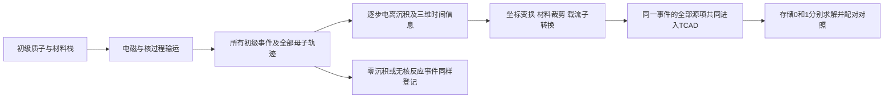

# v4 粒子源与响应接口合同草案

状态：设计草案，尚未实现、冻结或通过运行验收。参数和容差缺口见下文；不会被现有运行器自动读取。

学习后已补 [多HeavyIon实施候选及核事件能量账本](stage1/transport-design.md)。每个初级粒子应分别保存源面与入硅面的状态；核反应版本不能机械沿用旧“沉积不超过初级动能”的5MeV检查，完整能量守恒须包含适用的核Q值/逃逸等项。

## 两条粒子路线

已给出材料适用的 LET 时无需再为获得这条理想源执行 Geant4。仅给能量时，必须先建立种类—材料—阻止本领关系；常 LET 直线是显式近似，不能自动代表弯折、射程终止或高能次级逃逸。

先相加的是同一事件的生成源 G(r,t)，随后进行一次相应初态的非线性器件求解；不能相加每条径迹独立求解的响应。零沉积事件保持初级事件分母，允许精确复用匹配对照，但不能伪称独立求解。

## 输入与事件记录

| 层级 | 必需字段或记录 |
|---|---|
| request | schema_version、request_id、device_version/geometry_hash、材料栈、dimension、storage_bit、route、粒子种类、能量或 LET 及单位、三维起点、方向单位向量、角度约定、随机种子、初态/时序/温度/偏压、对照 ID |
| event | campaign/source_run/event_id 组成全局唯一 ID；seed/RNG 信息；初级粒子；核反应标志；轨迹数量；总/非电离/电离沉积；零沉积标志；生成失败与物理零响应分别记录 |
| track | event_id、track_id、parent_id、particle/PDG、离子 Z/A（适用时）、生成过程、出生动能/位置/方向/时间、终止状态；无有效沉积的轨迹仍有记录 |
| step | event_id/track_id/step_index、材料与体积、前后端点、步长、前后动能与方向、前后全局时间、限制该步的过程、总沉积、非电离沉积、电离沉积 |
| source | 来源 step 关联、目标材料、坐标变换、核函数/宽度/时间分布、域内/域外/裁剪积分、生成对数、输出网格/文件哈希；零源有显式记录 |
| response | event_id + storage_bit + device_version + numerical_config；signal/control 的真实 run ID；全曲线、端口电流、节点电压、连续指标、分类、退出码/收敛/失败记录 |

LET 路线也分配 event_id；input_mode 明确表示使用能量还是 LET。若两者均给出，必须声明主输入与校验关系；缺字段、单位含混、非单位方向向量或冲突参数在提交前报错。随机种子不单独充当事件 ID。

建议中间单位固定为 µm、ns、MeV、MeV·cm²/mg 和 fC；到 TCAD 边界显式转换成其命令要求的单位。每份记录同时写单位、坐标系原点、轴方向与手性。极角相对器件法线，方位角和旋转顺序要冻结；不能只留一个“30°”字段。

## 电离量与生成量核对

以单个材料内的逐步局域沉积计量为起点。Geant4 的总沉积、非电离沉积及其差分别保存，核对所用过程的定义；不能把初级粒子损失的全部动能又叠加到已显式输运的次级沉积，造成重复计数。对硅可采用每对电子—空穴的平均生成能 W_eh（单位 eV）做转换，数值及温度依据需在实现前冻结。

对映射到硅器件域内的电离沉积：

`N_eh = E_ion,in[MeV] × 10^6 / W_eh[eV]`

`Q_pair[fC] = N_eh × 1.602176634 × 10^-4`

`∫G(r,t) dV dt = N_eh`

Q_pair 是按一个载流子电荷计的生成规模，不能把电子和空穴再乘 2；它不等于存储节点最终收集电荷。复合、漂移扩散、端口交换和电路响应另由 TCAD 决定。

常 LET、均匀材料、直线段长度 L 的检查公式为：

`E_ion[MeV] ≈ LET[MeV·cm²/mg] × ρ[g/cm³] × L[µm] × 0.1`

该式只适用于已定义为相应电离源代理的 LET；若来自电子阻止本领近似，记录限制、次级电子处理及能量随深度的变化。NIST 常用 MeV·cm²/g 表值转为 MeV·cm²/mg 时除以 1000。NIST 的 nuclear stopping 指弹性碰撞向反冲原子的能量传递，不能替代核反应次级模型。[NIST 量的定义](https://physics.nist.gov/PhysRefData/Star/Text/appendix.html)、[PSTAR](https://physics.nist.gov/PhysRefData/Star/Text/PSTAR.html)。

积分账目分别给出源域总量、可映射材料域内量、排除材料/域外量和数值映射误差；不把域外能量重新归一化压入器件。跨界核函数如何截断、径迹如何分段，必须有解析或独立积分检查。氧化层沉积不能使用硅 W_eh 强制变成硅生成源。

三维保留 z。二维调试必须声明有效厚度、沿第三维的积分方式及端电流/电容归一化；缺少这些信息拒绝映射，不能通过删除 z 解决。几何旋转/平移至少用原点、三个轴向点和一个倾斜径迹验证。

解析/离散映射积分的候选容差：绝对误差 ≤ max(10^-6 fC, 10^-3 × |Q_pair,in|)，仅作为待冻结的接口数值目标；先进行独立积分/网格加密检查再决定是否可达。TCAD 网格上的实际生成量另设验收项，其容差须在网格验证后、正式批次前冻结；不能把映射侧容差自动套到器件离散求解。不得在看到器件预测后放宽。零源、极小源同时使用绝对与相对误差；报告电子对数与电荷两个单位。

## 响应与物理约束

signal 与 control 必须具有相同器件、偏压、存储初态、温度、时序、数值设置和观测时刻。

- ΔVsn(t) = Vsn_signal(t) − Vsn_control(t)。
- ΔQsn(t) = Qstore_signal(t) − Qstore_control(t)；常数存储电容且板极条件相同时才可写成 Cstore × ΔVsn(t)。电荷符号保持，不取绝对值替代标签。
- ΔVBL(t_read) = VBL_signal(t_read) − VBL_control(t_read)。
- margin = (2 × bit − 1) × (VBL − Vref)；Δm = margin_control − margin_signal，正值表示裕量损失。冻结 Vref 的实现和观察时刻，不把 Δm 直接等同 ΔVBL。
- 分类包含正确、判据误读、临界、数值不确定，以及失败/缺失；后两者是工程/数值状态，不能隐含算作正确。v4 阈值待基准和分辨率确定，v3 原阈值保持不变。

若节点具有多个电容或耦合，先对各支路 Q_k(V) 求和定义 Q_node，再检查积分 KCL：

`r_KCL(t) = ΔQ_node(t) − ΔQ_node(t0) − ∫[t0,t] ΔI_noncap,into(τ) dτ`

电流正方向统一为流入节点；电容支路不能既计入 Q_node 又计入非电容电流。TCAD 端电流是否含位移分量、器件结电荷如何分配须核对后冻结，避免重复计量。该残差是模型定义下的检查，未完成支路核对前不能声称守恒已验证。

辅助预测与评估应包含足够的 Vsn/电荷/积分电流量。若 ΔQ 标签本来就是 CΔV，电荷—电压罚项属于代数一致性约束，必须用去约束对照和独立电流残差区分其效果。测试响应曲线不作为预测输入，训练可拟合物理参数只来自训练子集。

## 工程与数值验收清单

| 类别 | 要验证的行为 | 放行依据 |
|---|---|---|
| 源项 | 单轨迹、多轨迹、零源、错时、倾斜、跨界/材料、网格积分 | 每种有输入哈希、独立积分、实际源输出与误差；顺序重排不应改变源 |
| 器件 | 无粒子电学、保持、读出；网格/半时间步；临界附近 | 预登记连续量容差和分类稳定性；跨界保留数值不确定，不能仅以收敛放行 |
| 正常完成 | 工具/SSH/归档各自退出码、日志完成、观测终点、有限数值 | 真实命令、版本、输入输出哈希，COLLECTED 不等于物理通过 |
| 中断恢复 | 本地或远端中断、已完成未归档、失联 | 只读核对进程/锁/原始退出记录后恢复；状态未知不得自动重提 |
| 重复请求 | 同 ID 同哈希和同 ID 异哈希 | 前者返回既有状态/证据，后者冲突拒绝；重试另有 attempt_id，事件 ID 不变 |
| 输入失败 | 缺字段、未知单位/材料/坐标、冲突能量与 LET | 提交前拒绝并保留错误，不补默认物理参数 |
| 未知退出码 | null、无法识别或丢失退出证据 | 标记 ENGINEERING_UNKNOWN，保留原记录，不推测为 0 |
| 串行约束 | 主代理唯一调度、单线程和既有锁 | 实际命令与进程核对；不为 v4 建第二调度者 |

实现细节（多源在现有 Sentaurus 版本中的可用接口、W_eh、源宽度/时间核、容差、物理列表/数据包、三维器件范围）均需先确认再冻结。参考 [Geant4 官方物理列表指南](https://geant4.web.cern.ch/documentation/dev/plg_html/PhysicsListGuide/index.html) 选择适用过程；在线文档版本不代表本机已安装版本。
