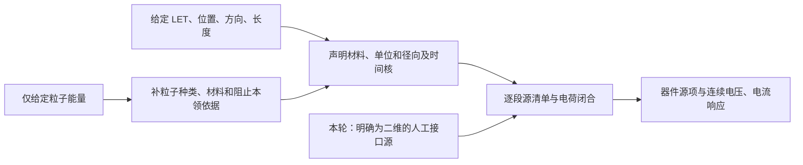
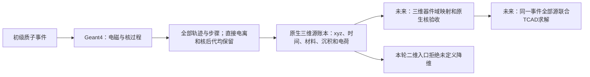

# 两条物理路线及当前边界

## 直接源路线

本轮A0–A8采用预先声明的二维人工源；1 fC、0.03 µm和2 ps等是接口参数，不冒充由某个真实能量粒子推导出的径迹。完整19角色的实际完成状态见[执行报告](report.md)。总量、空间、时序和细化须分别通过，不能凭相同端电压判定注入正确。

## 质子输运路线

本轮已取得**厚硅核机制记录见证和离线三维账本**，尚未取得三维DRAM响应。账本记录与裁剪核可追溯，但不等于原生三维TCAD源核已经验证。

初级事件始终是统计关联单位。不能分别求每条次级的器件响应后简单相加，也不能把多轨迹沉积压缩成单条均匀直线。厚靶保留自己的几何、时间与材料，不能平移缩放进DRAM；其计数不进入DRAM训练集、翻转截面或空间谱发生率。

## 预测模型的进入条件

先取得同一器件系列的无源电学依据、已验收的源项和连续响应，再冻结按初级事件、存储状态、尺寸及能量划分的训练测试组。源生成量、端口电流积分、存储电容电荷变化是不同观测，不能混称“收集电荷”。若标签本身由`CΔV`计算，再施加同式约束只能检验自洽性，不能单独证明模型获得了独立物理信息。

普通岭回归、去约束模型和物理约束模型，以及25%／50%／100%学习曲线仍是下一阶段任务。本轮没有训练、翻转标签、正式160事件矩阵或空间谱计算。
