# 首月质子实验重设计审查 r0.6

## 1. 本轮冻结的科学决定与自包含审查背景

本文件记录 2026-11-17 设计审查及落地决定。用户已明确授权整套计划上线执行且不再逐阶段询问，最新授权和自动放行条件见 [EXECUTION-AUTHORIZATION-r06-20261117.md](EXECUTION-AUTHORIZATION-r06-20261117.md)。本文的 P0 科学验收继续有效；原任务、旧 r0.5 清单、失败和原始归档保留。部署只沿原唯一调度者进行，不另建资源池。

### O1 / O2 / O3 审查项定义与处置

| 审查代号 | 含义 | 本轮决定 | 依据与约束 |
|---|---|---|---|
| **O1** | 虚拟机内存与并发/线程配置 | **11 核 / 28 GiB，当前先做 1×10，10×1 暂缓** | 5×2 已收集四项成功及一项用户停止的失败。先比较同类 D0 任务的 1×10 耗时、CPU、内存和收集结果，再决定正式配置。此前短 DC 的吞吐仅覆盖其测量范围。具体变更与历史候选见下文 |
| **O2** | 限制进程内重复回调及初始化日志，保留关键进度、警告、错误和完成摘要 | **2026-11-17 用户确认按本条修订（P0 落地）** | 实测每实例 `if (n <= 512)` 在约 24,106–27,200 个实例下仍产生千万行日志。采用进程/插件全局原子计数与有界输出；不设“百行级”硬指标，不预设提速倍数，不改粒子源数据、物理公式、方程、mesh 或求解设置。以文件大小、实际耗时和事先冻结的数值一致性标准验收 |
| **O3** | 验证保持窗注入时序，以 22 ns 为候选，检查附近时刻后再冻结正式输入 | **2026-11-17 用户确认按本条修订（P0 落地）** | 旧 r04 约 15 ns 注入仍在写 SN1。18.2–30 ns 是计划中的保持阶段。以位线和存储节点波形确认可实际注入的稳定时段，再比较 22 ns 和附近时刻，并记录到 31.9 ns 读出的时延及数值误差。详见第 4 节 |

### O1 扩并发候选

2026-11-18 后续执行更新。用户判断 D1 写 1 存在求解困难，要求先停止并改跑 1×10。原 D1 写 1 已沿原任务收集为 `FAILED_COLLECTED`，退出码 143，五项 5×2 任务的收集证据和槽位释放均已核对。10×1 尚未启动。当前原共享池只运行一个十线程 D0 O2 b0 性能副本，使用虚拟机 CPU0–9，CPU10 留作后台余量。原自动派发控制器在测试期间暂停，原性能测试服务负责等待和收集。原始数据、失败记录及各任务身份保留。此次副本新增独立科研样本数为 0。完成后先对比相同 D0 输入的耗时与资源记录，整批吞吐仍需相应并发实测证据。下述 5×2 → 10×1 为前一轮候选安排。

扩容前虚拟机为 9 核 / 28 GiB，TCAD 原调度为 4 并发 × 2 核。当时的虚拟机可用内存快照在 20.72–26.15 GiB 之间，四条运行时的短采样未见交换读写。容量评估采用两轮实测中任务重叠期的两端可用内存、交换读写、求解器内存峰值和收集开销。

两轮均使用虚拟机的 10 个求解核，留 1 核处理后台工作。服务器另有 3 核在虚拟机绑定范围外。切换前核对虚拟机 CPU 绑定、原 runner 槽位、全池收集状态及空闲锁。启动后验证实际准入、线程及许可签出。若整批吞吐、数值、资源或许可表现不支持 10×1，继续采用原长期调度配置。

2026-11-18 用户修订本轮对照为 5×2 → 10×1，取消 6×1+2×2。本次实测服务器已为 14 核，虚拟机已为 11 核 / 28 GiB。先让当前五项自然结束，并由原 runner 逐项验签收集、释放槽位，再在原共享池测试十个单核任务。10×1 使用虚拟机 CPU0–9，CPU10 留作后台余量。正式配置在两轮结果比较后决定。

每个配置同时记录服务器 CPU 忙碌率和虚拟机 CPU 忙碌率的最低、最高、平均值，服务器可用内存和虚拟机可用内存的最低、最高值，求解器工作集峰值、交换读写、OOM 计数、许可签出、单条 wall/CPU 时间、完整批次 wall 时间及验签收集完成吞吐。以虚拟机和服务器可用内存最低值判断压力，以完成并验签的有效条数/小时判断吞吐。出现 OOM、持续换页、许可失败、未解释的工程失败或数值验收不一致时，该配置不能作为生产默认。通过全部检查后优先选择吞吐最高者；吞吐接近时选择内存余量更大、波动更小且单条延迟更低者。

14 核服务器的扩容重启和虚拟机 11 核配置已完成。此前的 30 分钟规则只用于重启前决定是否等待在途任务。本轮 5×2 自然结束后沿原 ID 收集，全部收集释放后切换。

本轮 5×2 的五项是 D0 O2 b0、D1 无粒子 b0/b1、D2 无粒子 b0/b1，分别沿用各自的科学验收状态。10×1 从五项原 run 的冻结 inputs.tar 各派生两个性能副本，以十个新 run ID 填满十槽。唯一计算参数变化是线程数统一为 1，同时核对命令行、project.json 的 native_threads/native_cores 和 deck 声明。mesh、源项、物理、读出时序、步长及输出要求沿用原件。原始与副本的逐文件 SHA、差异及谱系记录在 local_runtime/r06-compare-20261118/comparison-inputs.json。

两轮工作量分别为五条与十条，报告逐类单条耗时和各类配平后的完成速率，同时保留完整批次墙钟，注明长尾、失败、收集耗时及满载重叠区间。五条的原始批次耗时与十条的原始批次耗时分别列出，吞吐按相同任务种类的比例和实际条数计算。各副本均为性能重复，新增独立粒子数和训练样本数为 0。D0 的 5×2 deck 虽写线程数 1，原生日志确认 assembly/solver 实际均为命令行指定的 2；记录这一覆盖关系。D1 b1 的收敛长尾一并保留。所有失败、中断、缺采样和未决证据保留。

### 核心设计决策总表

| 项目 | 冻结决定 | 适用边界 |
|---|---|---|
| 研究时序 | 保持窗18.2–30 ns，22 ns为候选；先验证附近时刻的敏感性，再冻结正式时序版本 | 现有planned字段不证明验证通过。最终时刻/协议变更先冻结新版本及哈希；P0按证据自动放行，不再等待用户逐项确认 |
| 设计结构 | 方案 B：4 个单因素锚点（`D0–D3`）+ 6 个锚点感知 `maximin_lhs` 开发 profile（`LHS01–06`）+ 3 个留出 profile（`H0` 长栅长外推 + `H1/H2` 逐轴范围内稀疏组合留出） | 共 13 个 profile、396 条 planned case；`H1/H2` 不声明联合凸包内插值；不声称可识别全部 15 个两两交互 |
| 存储状态 | b1 优先；b0 在 `S/HR/HP` 中约为分层 b1 的四分之一匹配子集，`T` 中 `D0–D3` 保留 `b0` 非对称探针 | b0 必须与同 `(profile_id, radiation_id)` 的 b1 成对；无 b0 事件不推断 b0 截面 |
| 阈值样本 | 基于真实参考沉积模板（`shape-a` 锚定 `G0`、`shape-b` 锚定 `C1`）按自适应二分试探（标称 `×10 → ×3/×30`）缩放 | `scale_factor > 1.0`，只用于阈值标定与边界学习，`statistics_eligible=false` |
| 辐照分配 | `S` 120 条 b1 均衡覆盖 10×8 开发矩阵（每单元 1–2 条，每池 15 条）；`R` 覆盖全部 8 开发池；`HR` 每锚点 3 `C2` + 3 `C3` | 所有 `S/R/HR/HP` 显式绑定 `radiation_id`；`AL` 82 条保持 `profile_id/radiation_id=null` 至 P2 后动态选取 |
| Geant4 批策略 | 8 个开发条件，`C2/C3` 封存；当前实际去重97池（开发72/HR6/HP19） | 按实时字节、在途归档及各层物理余量分波，服务器至少留20 GiB；不是固定2–4几何安全，不同时滞留全部原包 |
| 下游衔接 | [R06-HANDOFF-AND-PREDICTOR-CONTRACT.md](R06-HANDOFF-AND-PREDICTOR-CONTRACT.md)及最新执行授权 | 原唯一Runtime接管，计划/输入/门禁先冻结，原历史任务及队列谱系保留 |

### 2026-11-17 用户确认的锚点执行口径

保留D0–D3四个锚点及现有参数定义：D0为基准，D1仅将几何栅长改为0.8倍，D2仅将硅鳍宽度改为0.8倍，D3仅将受主掺杂倍率改为0.5倍；几何栅长不能替代有效电学沟道长度。每个锚点先通过各自b0/b1无粒子写入、保持和读出验证，再进入依赖其基线的粒子响应比较。先比较事件与该锚点自身的匹配无粒子对照，再比较锚点之间的差异，不能用D0的对照替代其余配置。若某点无粒子时已经读错、漂移超出事先标准或数值未决，暂停该点的粒子提交并保留证据；不将其计为粒子翻转，也不为通过而无记录调整参数或判据。20%几何扰动及掺杂减半是本研究选定的幅度，不代表已验证的制造波动或全因素最优设计。6个LHS点及后续预算继续逐项核对，本条不表示其已获整体确认。

### 2026-11-17 用户确认的 H0–H2 留出点口径

保留 `H0` 以及当前 `H1/H2` 坐标，不重新选点。`H0-long-channel` 是 `Lg=1.2×` 的长栅长外推点，其余参数为基准值；开发点中 `Lg` 的最大值约为 `1.05987027×`，所以 `H0` 明确用于检查离开开发范围后的外推能力。

`H1-lhs-holdout-a` 与 `H2-lhs-holdout-b` 改称**逐轴范围内稀疏组合留出**。它们是在 10 个开发点 `D0–D3 + LHS01–06` 的每条参数轴实际最小值和最大值之间选出的组合点，坐标保持为：

| 留出点 | `Lg` | `Wfin` | `Tox` | `Hjc` | `NA` | `ND` |
|---|---:|---:|---:|---:|---:|---:|
| `H1` | 0.83482929 | 0.84603376 | 0.89437912 | 87.03973794 nm | 0.56681586 | 1.28130966 |
| `H2` | 1.00466722 | 1.13875002 | 0.89056367 | 89.87346597 nm | 0.60528300 | 0.67323892 |

当前机器清单记录的生成证据为：`seed=20261118`、`candidates=10000`、到开发点及彼此的最小归一化距离 `0.7691216349240606`，最小归一化轴向内边距 `0.07993242120134582`。其中 `[0.08, 0.92]` 是生成候选点时的轴向内缩参数，不代表最终统一尺度下严格大于 `0.08` 的内边距。

因此，`H1/H2` 只证明每条轴都落在开发点的边际范围内，并且通过稀疏组合距离选择；当前没有通过联合凸包验证，不能称为“真正的域内插值”或“严格内部空隙”。它们用于验证模型对开发范围内、但训练中没有直接出现的多因素组合的泛化能力；如果以后需要真正的凸包内插值留出点，应另行按凸组合条件生成，不能把 `H1/H2` 改名代替。

## 2. 直接证据与接地核验（2026-11-17 实证）

1. **写入期混叠证据**：服务器 `experiments/dram-se-r04/electrical/prepare_write_read.py` 与 `mc2-event7377-b1-result-r1/README.md` 记录：SN2 写 `2–10 ns`，SN1 写 `10.2–18 ns`（`WL1=2.5 V`），`18.1–18.2 ns` BL 预充 `0.6 V`，`18.2–30 ns` 保持，`30.1–32 ns` 读 SN1（`31.9 ns` 采样）；旧 `r04` 源窗 `15.000–15.003 ns` 位于 SN1 写期内，不作为保持态 SEU 分母。
2. **双核源前配对阻塞与 Zero 耗时证据（关键补充）**：服务器最新 `mc2-b0-zero-pairing-result-r1/observations.json`（及当前 `observation.json` `2026-11-17T14:41:34Z` 仅剩 `b1 zero` 运行中）揭示：
   - `b0 zero`（`r04-l08-p000-nodal-whr-b0-zero-mc2-v1`）因继续加载 `Optics/pmi_r04_nodal`（24,106 个实例、11,228,368 行日志），自身耗时长达 **`14,889.86 s`（约 `4.14 h`）**；
   - 且双核环境下，`b0 zero` 与 `event0`、`event7377` 从第 3 行静态电路及 `t=1e-13 s` 起就出现 **`~1e-19 A` / `1e-16 V`** 数值微差，导致冻结比较器 `extract.py compare` 全部拒配对（`status: REFUSED, exit code 2`）。
   - **因此 P0 必须显式包含双核并行可重复性/容差配对根因诊断**，否则 `r0.6` 新跑完仍会因相同原因无法给出成对差分标签。
3. **几何域与接触坐标核验**：服务器 `experiments/dram-se-r04/model/model.py` 定义基准 `Tox=6, Lsn=20, Lbl=20, Lgt=14, Wfin=8, Hjc=82, Hfin=35 nm`，要求 `0 < x0 < x1 < 154`、`0 < gate_y0 < gate_y1 < 40`、`0 < fin_bottom < fin_top < 250 - Hjc < 250`。[build_r06_case_manifest.py](../../scripts/build_r06_case_manifest.py) 已内置同款盒边界验证，13 个 profile 全部满足可行域；同时提示服务器 `electrical_candidate.py` 落地多几何 SDE 时应按 `(x0 + Lsn/2)` / `(x1 - Lsn/2)` 动态定位接触面，避免硬编码坐标隐患。
4. **Geant4 耗时与磁盘实测边界**：服务器 `experiments/dram-se-r04/data/NATIVE-RESULTS-R1.md` 记录 6 次 `10^4` primary 输运事件循环仅 **`7.47–11.94 s`**（wrapper 总计 `21–29 s`），但单份 `results.tar` 达 **`92 MiB`**（`steps.csv` 占 `80.5 MB`）。据此估算 `10^5` 约 `1.5–2.5 min/run`（算力充裕，4 槽约 `~1 h`），但未压缩归档约 **`~0.92 GiB/run`**，必须靠分波次压缩/清理保护服务器 `~37.5 GiB` 虚拟机写入池与 `~54 GiB` 服务器根可用空间。
5. **为何 `Hjc` 无法减少本轮 Geant4 轮次**：虽然 `model.py` 中 `Hjc` 仅将纯硅柱切分为 `p_pillar` 与 `n_junction`（均为 `G4_Si`），但 `r0.6` 的 6 轴 LHS 点 `LHS01–06` 及 `D1/D2/H0/H1/H2` 在 `(Lg, Wfin, Tox)` 上彼此全部不同，故仍保留 12 个几何组（仅 `D0/D3` 共享 `crn-geometry-source-d0-d3`）；同时严禁跨开发/留出共享 CRN。

## 3. 目标、标签和统计边界

- 每个响应显式记录 `source_time_ns`、`deck_timing_version`、输入哈希、`source_shape_id`、`scale_factor`、`radiation_id`、`selection_mechanism`、`inclusion_probability` 与 `statistics_eligible`。入射动能、沉积能量、产生电子—空穴对数与收集电荷保持为不同字段。
- `threshold_scaled`（`T` 及 `HP` 阈值项）与 `active_learning`（`AL`）永不进入截面统计分母。
- `simple_random`（`R`）真实纳入概率为 `n/N`，当前未知则为 null；无权估计 `A_src*k/n`，不能将抽样错误数直接除以全池 N。
- `stratified_pi`（`S/HR/HP`）使用配额支持的完备粗层，每非空层至少1个，层内随机无放回，`π_j=q_h/N_h`；小配额自动合并层。b0另乘随机匹配子集概率。完整分母保留零沉积，但未决/未跑不自动标0；当前计划214个统计用途槽位均不等于合格样本，详见执行授权第3节。
- `b0/b1` 仅在同 `(profile_id, radiation_id, pair_id)` 共有同一入射事件时配对；`b1`-only 事件不生成虚假 `b0` case。
- `zero`（`Z`）是无粒子电学与配对对照，不是未翻转负样本。

### 2026-11-17 对齐：读出裕量与未决结果

用户确认临界结果可先记为“未决”，补充验证后再判定。`0.1 mV` 只用于报告精度目标。账本保留未舍入的读数和裕量、原诊断判定、补算身份、最终判定与依据。

- **先检查配对和读数。** 核对同一结构、写入状态、网格、时序与数值设置下的无粒子对照和粒子事件，检查源前配对、源积分与求解状态。保持窗候选方案取 `31.9 ns` 的原生位线电压。以 `0.6 V` 为当前读出参考，写 0 的裕量为 `0.6 V − V_BL`，写 1 为 `V_BL − 0.6 V`。分别保存对照、事件及其裕量差。裕量为正表示符合写入方向，为负表示相反。
- **再核对数值设置会不会改变读出结论。** 首轮使用同一事件及其匹配对照比较 `h` 和 `h/2`，保留实际接受的步长、拒步和电流、电压差。审查时间步、求解容差和必要时的网格影响，据独立验证结果界定适用的数值不确定范围。两级观测差是敏感性证据，不能直接当误差上限。旧电流比较器的冻结阈值及失败照原样记录。若需要新配对比较器，先记录适用范围和事前判据，再用独立输入验证后冻结版本。
- **读出方向有充分余量时才给标签。** 配对和其他前置均合格，且有依据的事件裕量范围整体大于零或整体小于零时，分别记未翻转或翻转（本协议下的 SN1 读出标签）。范围触及零、补算改变方向或证据不足时记“未决”，优先对同一事件和对照做针对性的细化或复算。输入、基线或求解异常保留对应的失败原因。补算逐条绑定原样本，沿用原纳入概率，只形成一个样本的最终结果。
- **截面汇总显式保留未决。** 随机抽中的未决或数值失败样本继续记录抽中身份、原纳入概率和总体分母。若仍缺二元结果，报告合格、失败和未决的数量及权重。必要时给出未解决结果全取 0 和全取 1 时的截面估计范围，单独报告抽样不确定性。两端仅用于说明缺失结果的影响，严禁以一端代替正式标签或将已解决子集冒充原概率样本。

上述条目用于细化 P0 证据和后续判定。正式比较器和读出误差口径须按执行授权第 2 节完成独立验证，再作为生产放行依据。

## 4. 阶段门与 P0 强验收流程

```mermaid
flowchart LR
  P0A["P0-1: 源前微差诊断 + O2 限制重复日志"] --> P0B["P0-2: 验证22 ns及附近时刻，再冻结时序"]
  P0B --> P0Z["P0-3: 13 profile Z 块无粒子写保持读体检"]
  P0Z --> U["执行方核查P0证据后自动放行"]
  U --> G4["分波次 Geant4 (10^5, 留出C2/C3封存) + 冻结 pi_j"]
  G4 --> P1["P1: D0-D3 锚点批 (T/S/R)"]
  P1 --> F1["拟合初版 R 与 Qcrit,eff，冻结开发基线"]
  F1 --> P2["P2: 6 个 LHS 开发 profile (T/S)"]
  P2 --> AL["AL: 开发池动态主动学习 (每批4条，收尾2条)"]
  AL --> V["V: 冻结模型后一次性解封 HR/HP 并评分"]
```

### P0 最低放行标准（缺一不可）

1. **双核源前配对可重复性解决**：定位并记录 `mc2-b0-zero-pairing-result-r1` 第 3 行静态/起跑 `1e-19 A` 差异根因（确定性求解开关或明确物理容差配对口径）；保留 `zero` 内一致性的 `Optics/PMI` 路径验证，不得凭空移除对照一致性检查。
2. **O2 日志控制验收（2026-11-17 用户确认）**：同一代表输入在相同并发/线程配置下比较修改前后版本，冻结粒子源数据、物理公式、mesh、求解设置与输入哈希；短探针核对源数据/源积分和电流、电压波形，完成至少 1 条代表长任务对比。数值一致性采用事先声明且有重复性及误差依据的标准，不以双核本已不能保证的逐位相同作为唯一判据，也不按输出结果临时放宽。统计日志行数、文件/归档字节数、wall/CPU 时间，检查重复输出受控且警告、错误、收敛失败与完成摘要保留；不设“百行级”或固定提速倍数。只有能从求解器接口确认的步状态才称“已接受时间步”，PMI 回调计数不冒充接受步汇总。并发/线程性能对比保持同一日志版本，日志优化效果另做对比。
3. **O3 保持窗时序验收（2026-11-17 用户确认）**。在 22 ns 用匹配对照和代表事件检查结果对步长的敏感性。同时，用正式 D0 的 b0/b1 无粒子全程结果检查写入、18.2 ns 后位线与存储节点的稳定时间、保持漂移和读出裕量，据此事先选出少量 22 ns 附近的候选时刻。候选时刻按下面的固定顺序产生。

   1. 第一轮先冻结三个候选时刻 `21、22、24 ns`，不根据粒子事件是否翻转删改。22 ns 是中心点，21 ns 检查前侧 1 ns，24 ns 检查后侧 2 ns，三个时刻都处于计划的 18.2–30 ns 保持阶段。先做这三个点，避免在第一轮把条件数量扩大。
   2. 只用 D0 的 b0/b1 无粒子波形筛选可用时段。每个候选时刻都检查它前后的局部电压斜率、位线与存储节点是否仍在写入转换或预充电转换中、两种状态的读出方向是否稳定、求解器是否有异常拒步或缺失输出。候选点必须落在两种状态共同满足这些条件的区间内。
   3. 从三个候选点中保留通过筛选的点。理想情况是 21、22、24 ns 全部保留。若 21 ns 或 24 ns 不满足稳定条件，保留 22 ns 和另一侧的合格点，并把缺失的一侧记录为窗口边界证据。若 22 ns 自身没有通过，暂停时序冻结，不能用附近点替代。只有这三个点显示出明显时刻依赖时，才增加 20 ns 或 23 ns 的补充诊断。
   4. 对保留时刻使用同一粒子事件、空间分布、幅度、脉冲形状、mesh、物理设置和读出时刻。只把源脉冲及其细步长窗口整体平移相同的时间差，其他电路 PWL 和 31.9 ns 原生读出保持不变。这样比较的是注入时刻影响。
   5. 记录每个时刻的注入瞬间电路状态、源积分、实际接受步分布、31.9 ns 读出裕量、相对于匹配 zero 的裕量变化，以及 h/h2 数值敏感性。变化若能由数值敏感性解释，标为数值范围内的差异。变化若超出已验证的数值敏感性，保留时刻依赖，不把 22 ns 外推到整个保持阶段。

   逐项核验源积分相对误差 `<1e-9` 和源前配对，记录注入时电路状态、到读出的时延、读出裕量及数值差。结果对时刻的差异使用 `0.1 mV` 作为报告分辨率，不把它当作放行阈值。若研究目标需覆盖明显不同的保持期时刻，再修订实验和预测输入。验收后冻结正式时序、读出协议、输入哈希和版本。旧 15 ns 结果保留为写入期证据。P0 时序诊断独立记账，396 条正式槽位和统计分母按原清单执行。
4. **13 个 profile `Z` 块（26 条）全量电学体检**：确认所有 10 个开发 profile（以及经隔离审阅仅检查写电平/保持漂移/收敛可行性的 `H0–H2`——不泄露留出物理响应作调参）均能在 `r06-hold-window-v1` 时序下正确完成写 0/1、保持与读出，避免把电学无效点提交到 6 小时/条的粒子瞬态队列。

P0 由执行方核对证据后自动放行 P1；用户已授权无需再次确认。失败仅阻塞相应依赖，不能为继续而改标通过；诊断探测不填入正式科研统计分母。
