# DRAM SEE v3 r4 证据快照

UTC `2026-10-12T00:34:06.043138+00:00`；状态 `SCIENCE_AND_NATIVE_REVIEWED_PENDING_FINAL_DOCUMENT_AND_DATA_PLOT_REVIEW`。

64独立事件、128配对位槽；训练64响应与测试64响应。四alias仅恢复原逻辑槽，全部原失败和未知退出码保留。

这是未校准二维1T1C的条件模拟。受控理想初态不等于实际写入；判据误读不等于持久位翻转；不能推出商业DRAM可靠性或辐射截面。

| 5 mV有效分类 | 数量/128 |
| --- | --- |
| correct | 96 |
| criterion_error | 20 |
| critical | 8 |
| numerically_uncertain | 4 |
| failed | 0 |
| missing | 0 |

2.5/5/10 mV三阈值、每层N=4及未知包络见[分层统计](statistics.csv)。分类跨界、连续失败及未选近界不确定性均保留。

预算无上限；唯一原账本累计已登记 100022.07 s，未结 0 项、费用缺项 0 项。包含历史/失败/重试/验证成本。

[原r4固定模型评分](original-r4-prediction-scores.json)与[最终数值证据评分](final-numerical-prediction-scores.json)分别保存，未重新训练或修改预测。

[来源](sources.json) · [128槽](responses.csv) · [四alias和真实owner](response-sources.json) · [阶段](stage-verification.json) · [原失败](original-failures.json) · [课程材料](materials/index.md)

真实原生PNG机器来源与逐图目视已作为collect门槛；以下新生成DATA PLOT还需主代理逐图核验。最终文稿/PPT需另行生成与逐页验收。

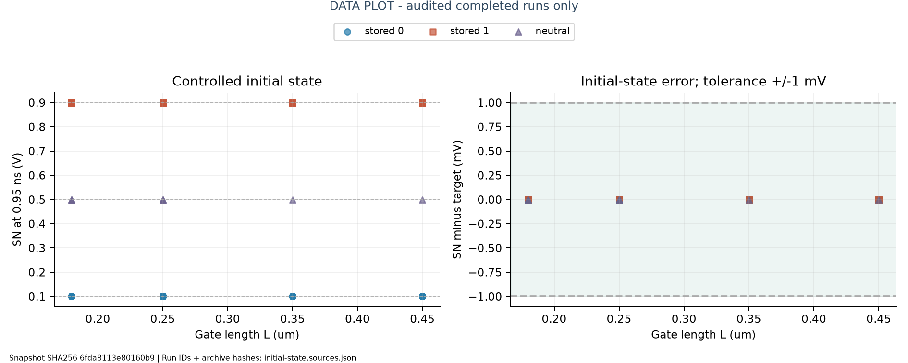

Actual audited prestrike samples; targets are guides, not simulated samples.；PENDING_ROOT_ACTUAL_IMAGE_INSPECTION。

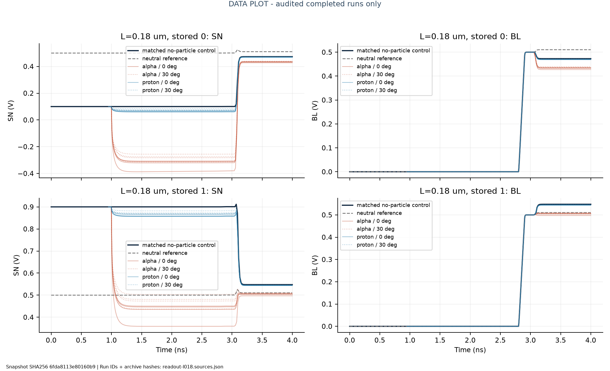

All available planned event curves, controls and neutral curves; missing curves omitted, no sample selection.；PENDING_ROOT_ACTUAL_IMAGE_INSPECTION。

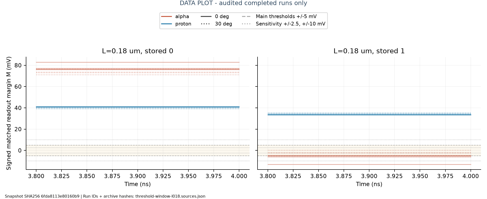

All available event margins in 3.8-4 ns. Guides +/-2.5, 5, 10 mV; crimson alpha, blue proton; dotted 30 deg.；PENDING_ROOT_ACTUAL_IMAGE_INSPECTION。

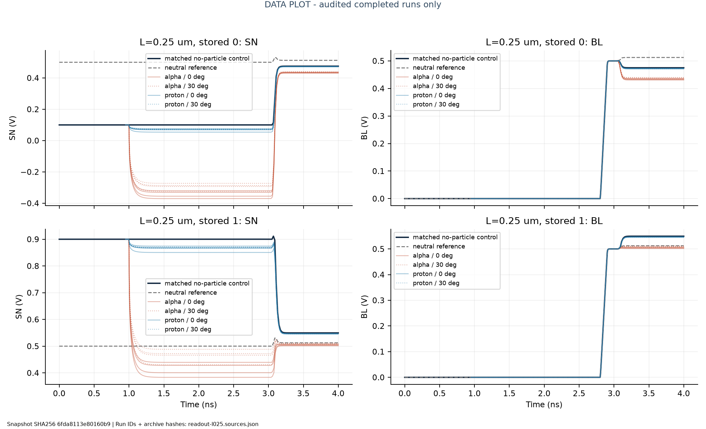

All available planned event curves, controls and neutral curves; missing curves omitted, no sample selection.；PENDING_ROOT_ACTUAL_IMAGE_INSPECTION。

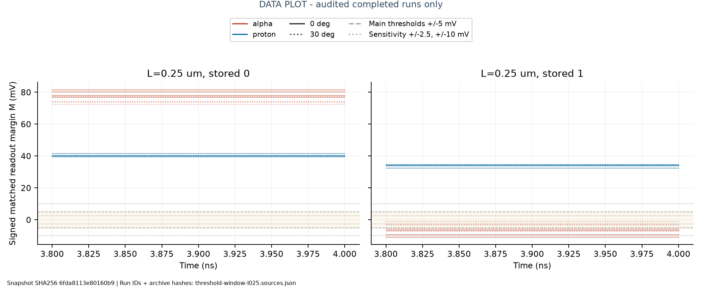

All available event margins in 3.8-4 ns. Guides +/-2.5, 5, 10 mV; crimson alpha, blue proton; dotted 30 deg.；PENDING_ROOT_ACTUAL_IMAGE_INSPECTION。

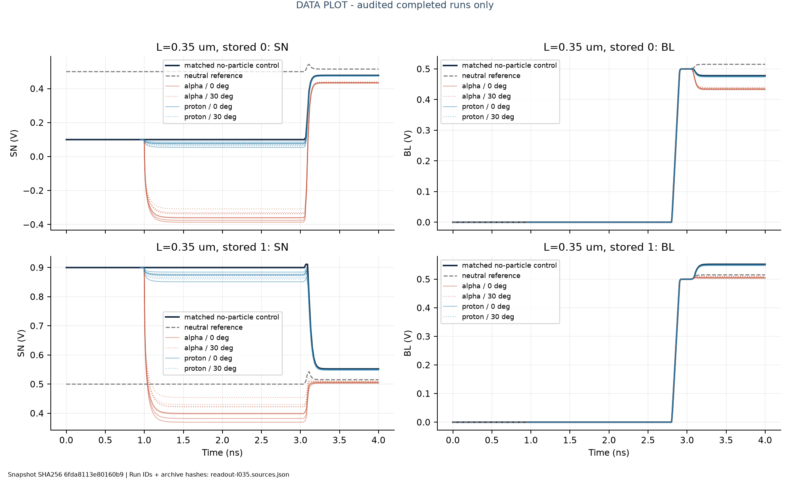

All available planned event curves, controls and neutral curves; missing curves omitted, no sample selection.；PENDING_ROOT_ACTUAL_IMAGE_INSPECTION。

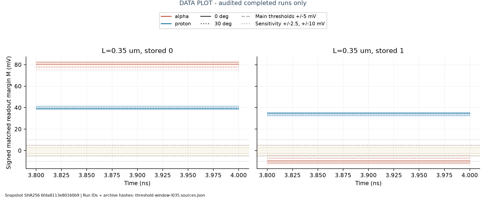

All available event margins in 3.8-4 ns. Guides +/-2.5, 5, 10 mV; crimson alpha, blue proton; dotted 30 deg.；PENDING_ROOT_ACTUAL_IMAGE_INSPECTION。

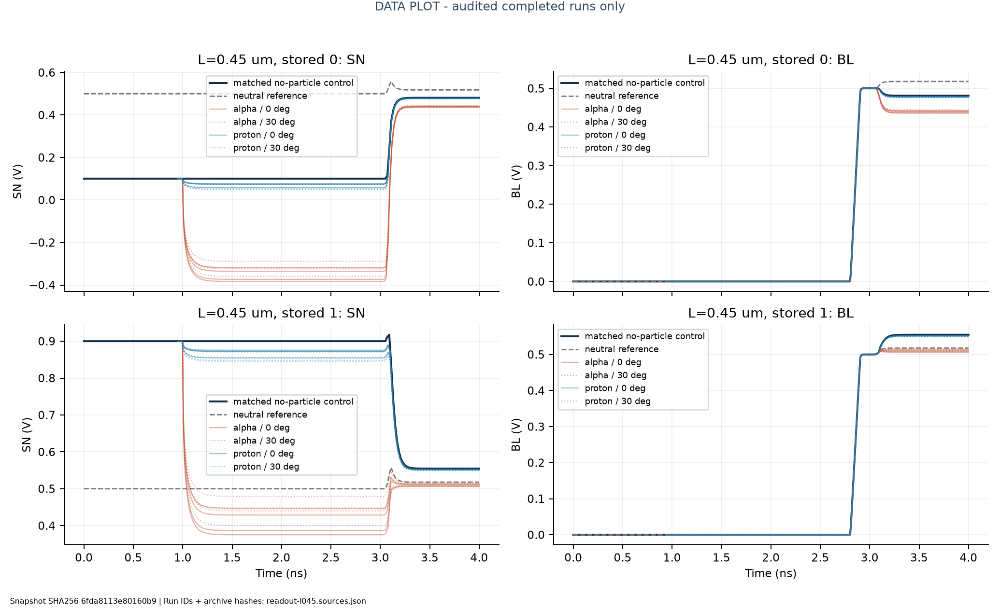

All available planned event curves, controls and neutral curves; missing curves omitted, no sample selection.；PENDING_ROOT_ACTUAL_IMAGE_INSPECTION。

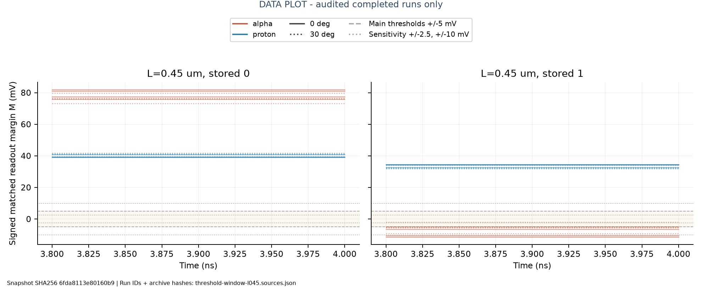

All available event margins in 3.8-4 ns. Guides +/-2.5, 5, 10 mV; crimson alpha, blue proton; dotted 30 deg.；PENDING_ROOT_ACTUAL_IMAGE_INSPECTION。

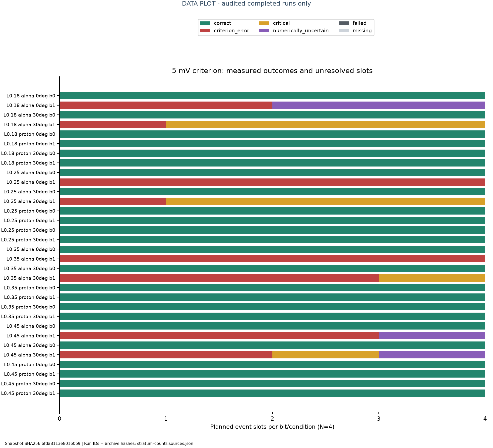

Fixed N=4 per bit/physical stratum; missing bars describe planned status, not measurements.；PENDING_ROOT_ACTUAL_IMAGE_INSPECTION。

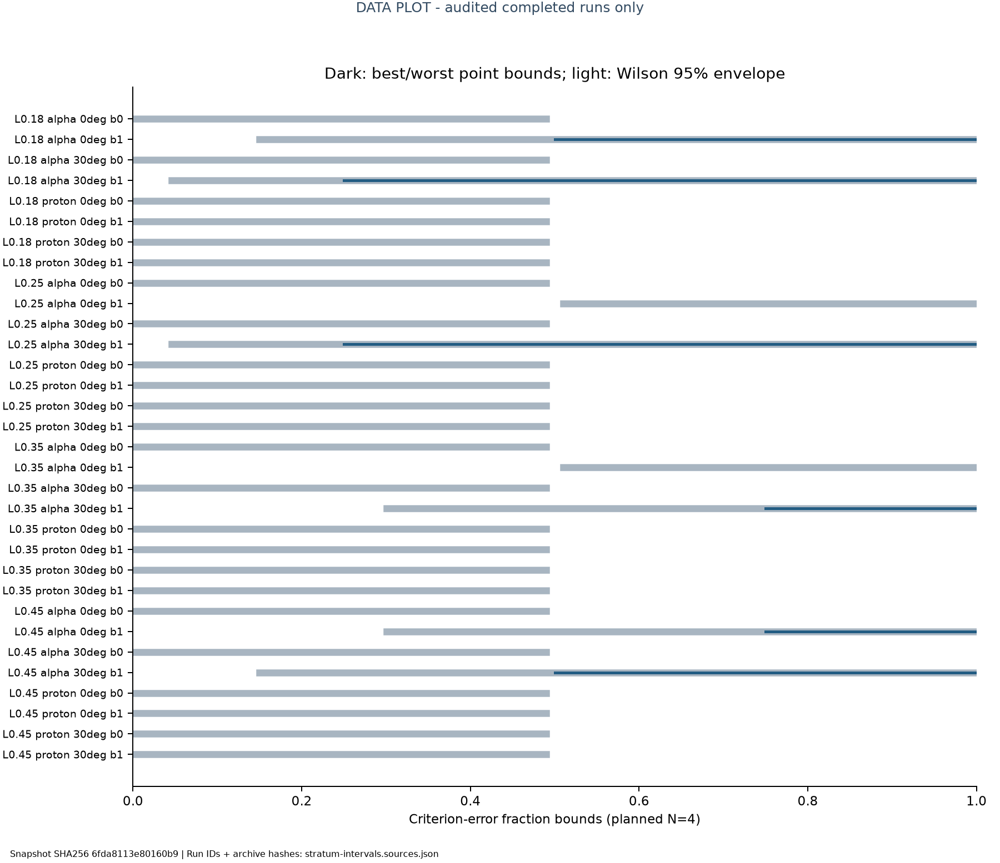

Only strata containing actual classified observations; descriptive envelope includes unresolved assignments.；PENDING_ROOT_ACTUAL_IMAGE_INSPECTION。

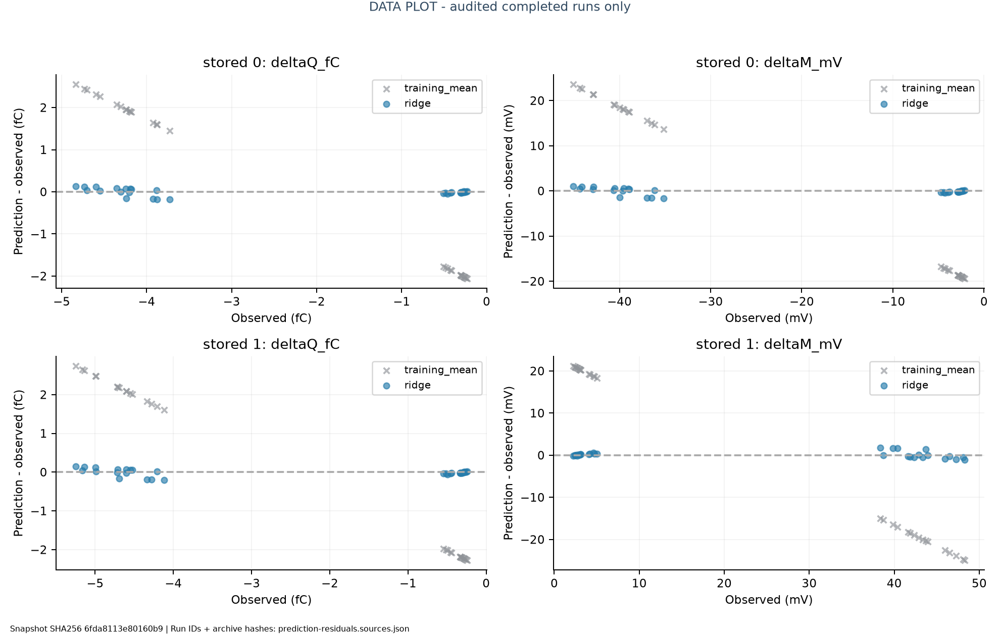

Actual holdout/extrapolation residuals for fixed pre-test models; missing responses omitted from points and counted in CSV.；PENDING_ROOT_ACTUAL_IMAGE_INSPECTION。

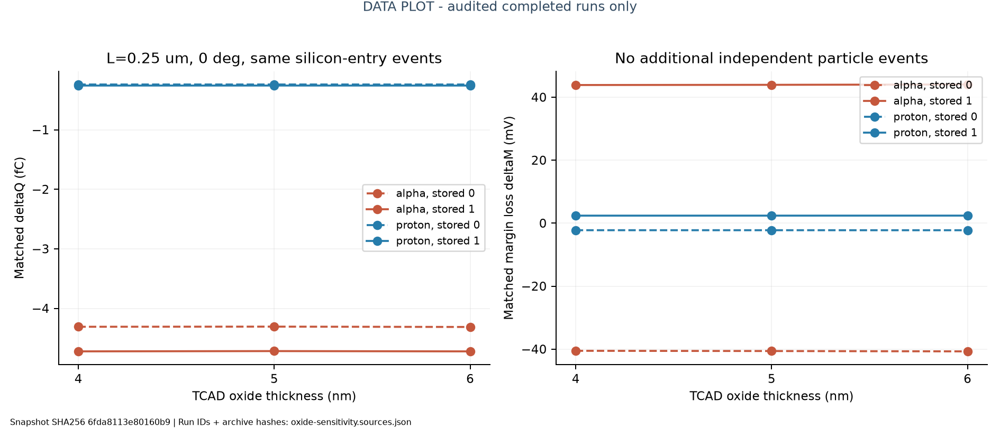

Fixed source events across 4/5/6 nm; 5 nm responses reused. Not a changed transport material stack.；PENDING_ROOT_ACTUAL_IMAGE_INSPECTION。

学生/教师活动不由程序代填；本快照与代理材料不表示课程全部通过。
